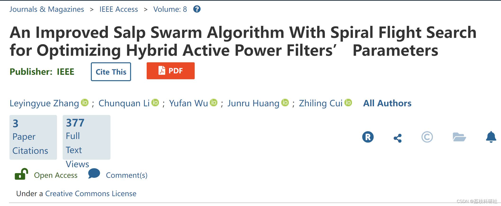
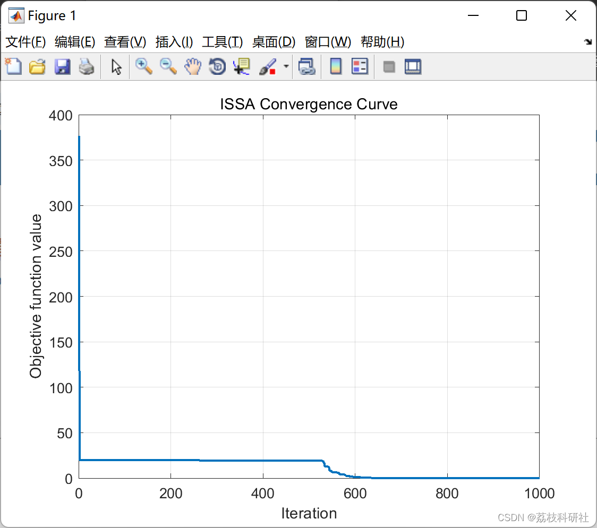
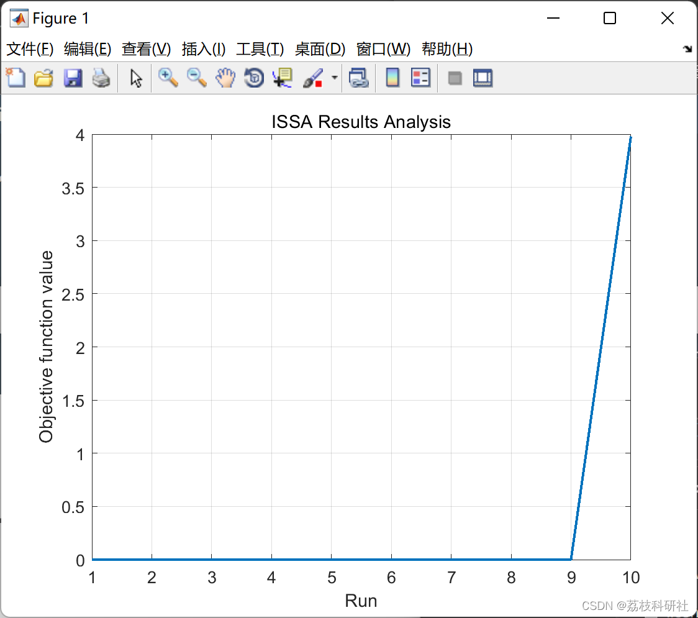

# Improved Salp Swarm Optimization Algorithm (ISSA) (Matlab Code Implementation)

​  
Editor
This paper proposes an improved Salp Swarm Algorithm (I-SALPS) based on the Spiral Flight Search Strategy (ISSA-SFS). This algorithm integrates the ISSA-SFS strategy, Multi-Leadership (ML) strategy, and Random Learning (RL) strategies with two improved evolutionary stages: the Improved Leading Phase (ILP) and the Improved Following Phase (IFP). In the ILP, the SFS strategy is introduced to enhance global search capability and avoid premature convergence. Additionally, in the ILP, a ML strategy that selects multiple leaders is proposed to further strengthen the global search capability of the proposed algorithm. In the IFP, a simple RL strategy is developed to learn two different random individuals, thereby effectively improving local development.
📚2 Running Results Editing
Editor
Part of the code:
%% Example for Rastrigin's Function  
fobj =@rastriginsfcn;     % Handle to the objective function (@fobj)  
Nvars = 30;          % Number of variables  
LoB = ones(1,Nvars) * (-5.12); % Lower Bounds  
UpB = ones(1,Nvars) * 5.12;  % Upper Bounds  
Ntot = 700;    % Total number of salps  
Ninit = 8 * Ntot; % The initial number of salps  
tMax = 1000;    % Maximum number of iterations  
%% Run ISSA for multiple times  
totRuns = 10;         % Run for a number of totRuns  
for nRUN = 1 : totRuns  
tic  
[FoodFit(nRUN,1),FoodPos(nRUN,:),ConvCurve(nRUN,:)]=ISSA(Ntot,Ninit,tMax,LoB,UpB,Nvars,fobj);  
RunTime(nRUN,1) = toc;  
end  
%% Results Analysis  
ISSA_min = min(FoodFit);  
ISSA_avg = mean(FoodFit);  
ISSA_med = median(FoodFit);  
ISSA_max = max(FoodFit);  
ISSA_std = std(FoodFit);  
display(['Improved Salp Swarm Optimizer'])  
display(['ISSA run ',num2str(totRuns),' times in ',num2str(sum(RunTime)),' seconds.']);  
display(['The best ISSA solution score is:  ',num2str(ISSA_min)]);  
display(['The median ISSA solution score is: ',num2str(ISSA_med)])  
display(['The average ISSA solution score is: ',num2str(ISSA_avg)])  
display(['The worst ISSA solution score is: ',num2str(ISSA_max)]);  
display(['The ISSA standard deviation is:  ',num2str(ISSA_std)]);  
%% Plot the sorted optimal solutions score  
figure(1);clf;set(1,'color','w')  
plot(sort(FoodFit),'LineWidth',1.5);  
title('ISSA Results Analysis');  
xlabel('Run');  
ylabel('Objective function value');  
grid on;  
%% Example for Rastrigin's Function  
fobj =@rastriginsfcn;     % Handle to the objective function (@fobj)  
Nvars = 30;          % Number of variables  
LoB = ones(1,Nvars) * (-5.12); % Lower Bounds  
UpB = ones(1,Nvars) * 5.12;  % Upper Bounds  
Ntot = 700;    % Total number of salps  
Ninit = 8 * Ntot; % The initial number of salps  
tMax = 1000;    % Maximum number of iterations  
%% Run ISSA for multiple times  
totRuns = 10;         % Run for a number of totRuns  
for nRUN = 1 : totRuns  
tic  
[FoodFit(nRUN,1),FoodPos(nRUN,:),ConvCurve(nRUN,:)]=ISSA(Ntot,Ninit,tMax,LoB,UpB,Nvars,fobj);  
RunTime(nRUN,1) = toc;  
end  
%% Results Analysis  
ISSA_min = min(FoodFit);  
ISSA_avg = mean(FoodFit);  
ISSA_med = median(FoodFit);  
ISSA_max = max(FoodFit);  
ISSA_std = std(FoodFit);  
display(['Improved Salp Swarm Optimizer'])  
display(['ISSA run ',num2str(totRuns),' times in ',num2str(sum(RunTime)),' seconds.']);  
display(['The best ISSA solution score is:  ',num2str(ISSA_min)]);  
display(['The median ISSA solution score is: ',num2str(ISSA_med)])  
display(['The average ISSA solution score is: ',num2str(ISSA_avg)])  
display(['The worst ISSA solution score is: ',num2str(ISSA_max)]);  
display(['The ISSA standard deviation is:  ',num2str(ISSA_std)]);  
%% Plot the sorted optimal solutions score  
figure(1);clf;set(1,'color','w')  
plot(sort(FoodFit),'LineWidth',1.5);  
title('ISSA Results Analysis');  
xlabel('Run');  
ylabel('Objective function value');  
grid on;  
🌈3 Matlab code implementation of editing
🎉4 References
​  

## Images

<!-- PAYMENT_BLOCK -->

## Get this dataset

- Payment link (Stripe): [Buy now](https://buy.stripe.com/3cs8yP7sY87d0vu9AB)
- Payment QR code: 

<!-- /PAYMENT_BLOCK -->
